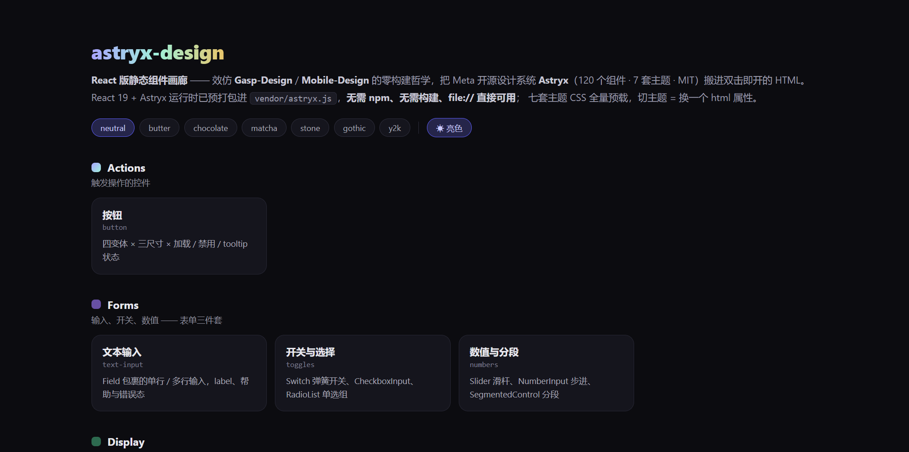
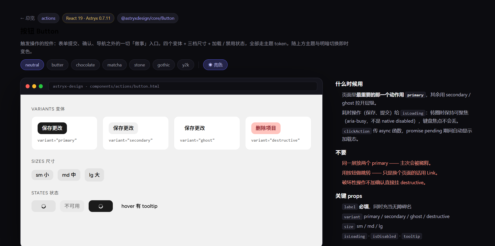
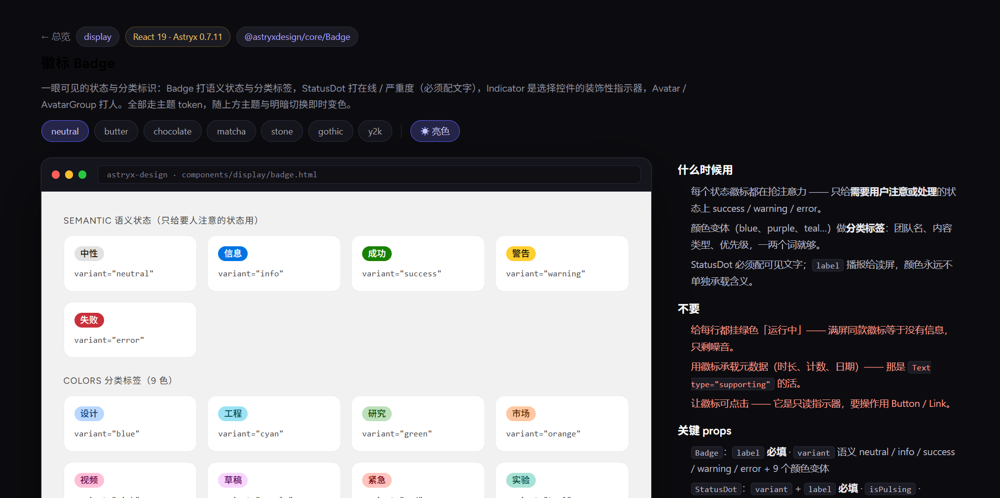
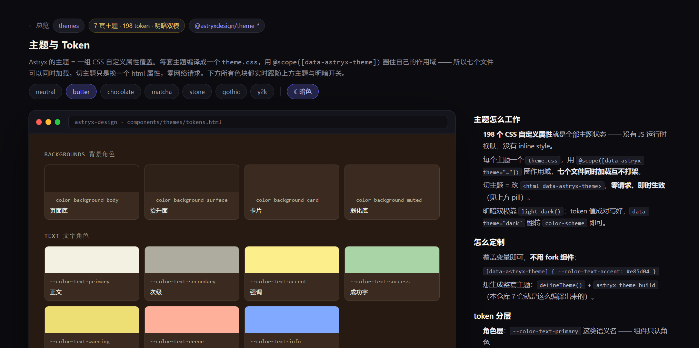

# meta-design

**React 版静态组件画廊** —— 把 Meta 开源设计系统 **[Astryx](https://github.com/meta/astryx)**（120 个组件 · 7 套主题 · 198 个 design token · MIT）搬进双击即开的 HTML。

React 19 + Astryx 运行时已预打包进 `vendor/astryx.js`，**无需 npm、无需构建、`file://` 直接可用**；七套主题 CSS 全量预载（各自 `@scope` 到不同属性），切主题 = 换一个 html 属性，零请求即时生效。

| 画廊总览 | 组件 demo（窗口壳 + 说明栏） | 徽标 / 头像 | 主题解剖（butter · 暗色） |
| :---: | :---: | :---: | :---: |
|  |  |  |  |

## 为什么是这个组合

- **Astryx 是「agent-ready」的设计系统**：API、文档、CLI 为人类和 AI 一起设计，组件文档可本地查询（`astryx component Button`）——本仓库每页的 props 都直接取自它的 CLI Props 表。
- **token 层可以脱离 React**：`theme.css` 是纯 CSS 自定义属性（267 个变量、零 JS 引用），所以主题解剖页连 React 都没挂。
- **静态化路径已验证**：esbuild 一次性打成 IIFE（`window.AstryxKit`），页面用 `htm` 写模板——**没有 JSX 编译步骤，每页都是可直接阅读编辑的纯 HTML**。
- **内置中文语言包**：每页包 `InternationalizationProvider locale="zh-CN"`，组件内置文案（分页、对话框按钮等）全部中文。

## 快速开始

```bash
git clone <this-repo>
```

双击 `index.html` 打开组件画廊，点任意卡片进入独立组件页。或部署到任意静态托管（GitHub Pages 直接可用）。

页面右上 7 个主题 pill + 明暗开关是全局的（偏好存 localStorage，跨页继承）。

## 组件清单

### `components/actions/` — 1 个

| 组件 | 说明 |
|---|---|
| `button` | 四变体（primary/secondary/ghost/destructive）× 三尺寸 × 加载 / 禁用 / tooltip 状态 |

### `components/forms/` — 3 个

| 组件 | 说明 |
|---|---|
| `text-input` | Field 包裹的单行 / 多行输入：label、帮助文本、动态 error↔success、隐藏 label 搜索框 |
| `toggles` | Switch 弹簧开关、CheckboxInput 三态联动、RadioList 受控单选组 |
| `numbers` | Slider 单值 / 区间（刻度、格式化、warning）、NumberInput 步进、SegmentedControl 分段 |

### `components/display/` — 5 个

| 组件 | 说明 |
|---|---|
| `card` | Card / ClickableCard / SelectableCard 三态卡片 |
| `table` | 数据驱动 Table：renderCell 组合、紧凑密度、网格线、条纹、列宽比例、数字右对齐 |
| `list` | List + ListItem（头像 / 徽标槽位）+ Item 密度 + MetadataList 键值对（多列 + 折叠） |
| `badge` | Badge 5 语义 × 9 颜色、StatusDot 脉冲状态点、Indicator 角标三件套、Avatar / AvatarGroup |
| `text` | Heading 层级、Text 五种 type、Blockquote、Link 五变体、Kbd 按键 |

### `components/overlays/` — 5 个

| 组件 | 说明 |
|---|---|
| `dialog` | Dialog（info / form / confirm 三 purpose）+ AlertDialog 确认框（含转圈与 Esc 关闭） |
| `sheets` | Drawer 侧滑（四向）+ BottomSheet 底部面板（snapPoints 吸附） |
| `popover` | Popover / Tooltip / HoverCard / InfoTip 轻量浮层 |
| `menu` | DropdownMenu 下拉菜单（分组 / 分隔 / 危险项）+ ContextMenu 右键菜单 |
| `toast` | `useToast()` 钩子 + LayerProvider：操作反馈、撤销按钮、自动消退 |

### `components/nav/` — 3 个

| 组件 | 说明 |
|---|---|
| `tabs` | TabList 受控选中：面板联动、三尺寸、fill 布局、分隔线 |
| `pagination` | Breadcrumbs 层级收缩 + Pagination（pages / count / compact / dots 四变体） |
| `side-nav` | SideNav + Heading / Section / Item：选中态、折叠子项、禁用、徽标尾槽 |

### `components/layout/` + `components/feedback/` — 2 个

| 组件 | 说明 |
|---|---|
| `primitives` | 布局范式参考：Stack / HStack / VStack 对齐、Grid 响应式与固定列、Divider、Section |
| `progress` | ProgressBar 确定 / 不确定（marks、语义色）、Spinner、Skeleton 错峰、EmptyState、Banner |

### `components/themes/` — 1 个

| 组件 | 说明 |
|---|---|
| `tokens` | 主题系统解剖：背景 / 文字 / 状态色角色、排版阶梯、圆角、阴影 —— 纯 CSS，无 React |

## 项目结构

```
meta-design/
├── index.html                 # 组件画廊总览
├── shared/
│   ├── frame.css              # demo 页舞台：深色 chrome + 浏览器窗口壳 + 说明栏
│   ├── frame.js               # 主题 / 明暗切换（7 pill + 模式轮换，localStorage 持久化）
│   └── gallery.css            # 总览页画廊样式
├── components/
│   ├── actions/<name>.html    # 每组件一个自包含 demo 页
│   ├── forms/  display/  overlays/  nav/  layout/  feedback/  themes/
├── vendor/                    # 预构建产物（提交入库，双击可用）
│   ├── astryx.js              # esbuild IIFE：React 19 + htm + @astryxdesign/core + zh-CN 目录
│   ├── reset.css  astryx.css  fonts.css
│   ├── themes/*.css           # 七套主题，全部 @scope 到各自属性
│   └── fonts/                 # Figtree woff2（自托管，不依赖 Google Fonts）
├── scripts/
│   ├── entry.js               # 打包入口（export React / ReactDOM / htm / Astryx / zhCN）
│   └── build.mjs              # 一键重建：JS bundle + CSS + 字体拷贝
├── docs/screenshots/
└── package.json               # 仅重建时需要；日常使用零依赖
```

**每个组件一个 demo 页**：固定骨架（页头标签 + 窗口壳 + `#root` 挂载点 + 说明栏三节「什么时候用 / 不要 / 关键 props」），内联脚本走同一套渲染模式：

```js
const {React, ReactDOM, htm, Astryx, zhCN} = AstryxKit;
const html = htm.bind(React.createElement);
ReactDOM.createRoot(document.getElementById('root')).render(html`
  <${InternationalizationProvider} locale="zh-CN" messages=${{'zh-CN': zhCN}}>
    <${Button} variant="primary" label="保存更改" />
  <//>
`);
```

## 约定

- **props 有据**：每个组件的用法先跑 `node node_modules/@astryxdesign/cli/clients/cli/bin/astryx.mjs component <名>` 查 CLI Props 表，只用表内合法值。
- **不改 Astryx 内部类**：页面样式只作用于自己的布局类（`.sec` / `.row` / `.vcell` 等），换肤一律走 token 变量。
- **React 段内 `className` 不写 `class`、`style` 传对象不传字符串**——这是 React 19 的硬规则（踩过：字符串 style 直接抛 error #62）。
- **无 Icon 组件**：图标注册机制未验证，槽位一律用文字 / 徽标 / 首字母代替。

## 重建 vendor（仅依赖升级时需要）

```bash
npm install          # 走 npmmirror：--registry=https://registry.npmmirror.com
npm run build        # 重新生成 vendor/astryx.js + 拷贝 CSS/字体
```

依赖锁定：`@astryxdesign/core@0.7.11`（React >= 19 peer）、七套 `@astryxdesign/theme-*@0.7.11`、`react@19.3`、`htm@3.1`、`@fontsource/figtree`。

## License

[MIT](LICENSE) · Astryx 版权归 Meta Platforms, Inc.，本仓库仅含其 MIT 允许的再分发产物与自写 demo。
